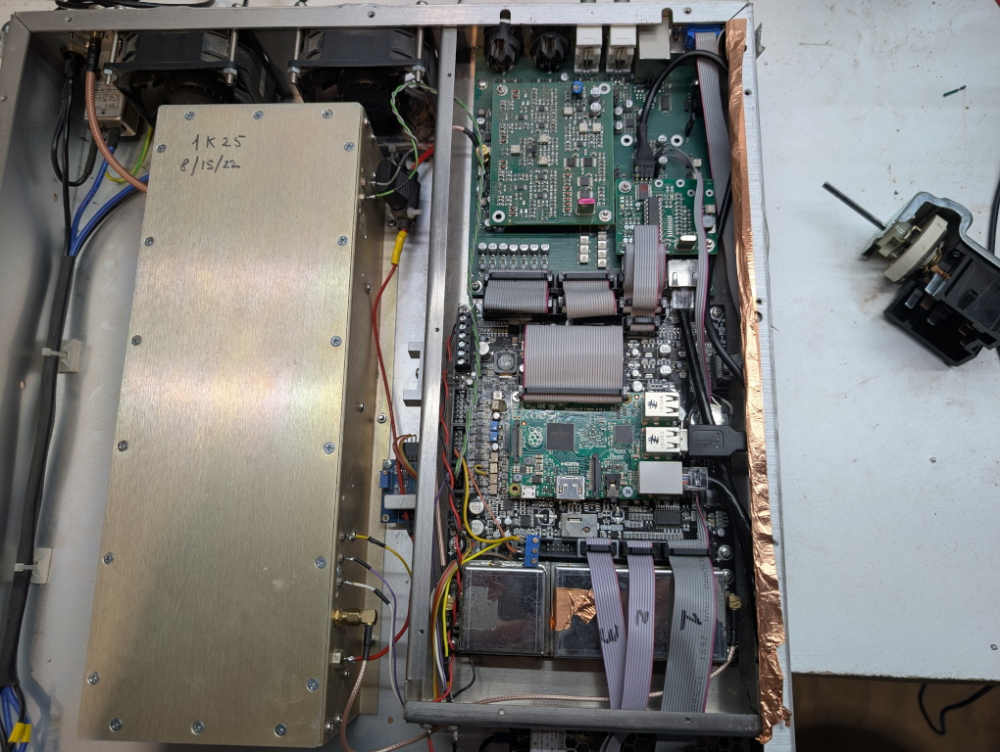
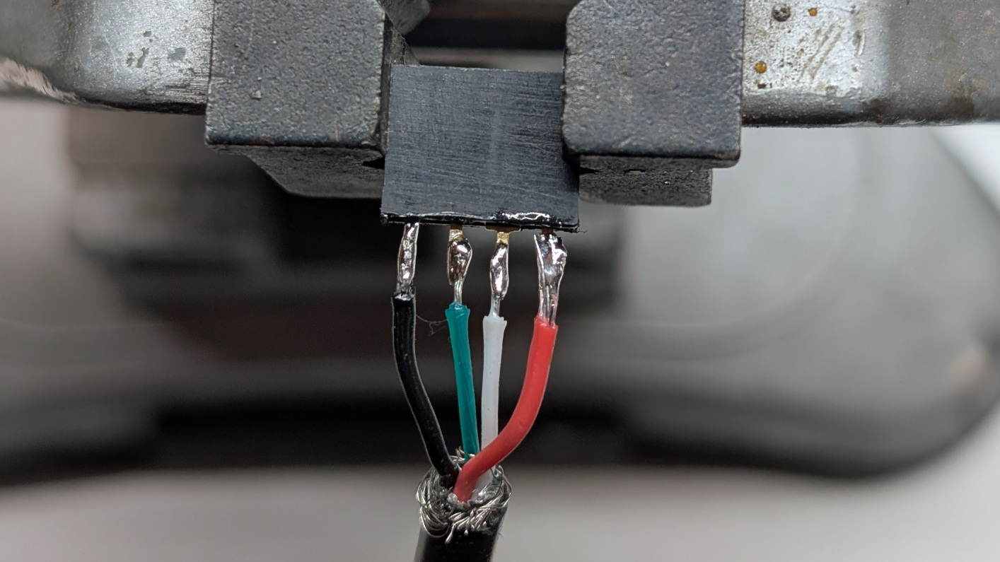
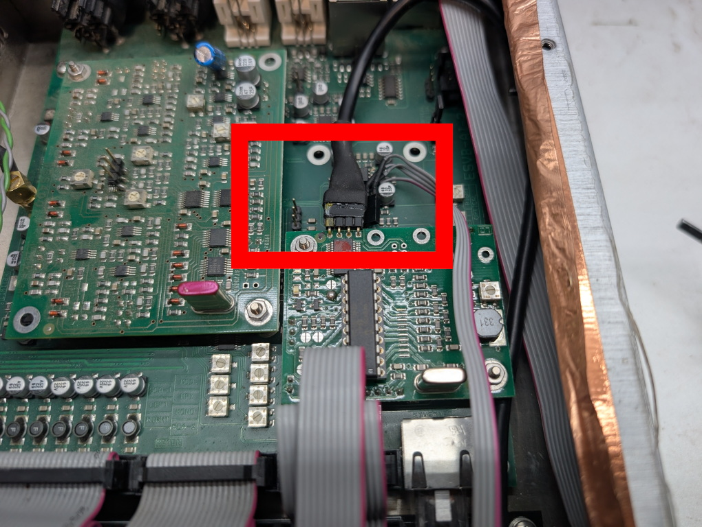

# NiCom Setup

This software was initially designed to run on the Raspberry Pi 2 built into NiCom NTi FM transmitters. The following are setup instructions for one directly out of the box. You will need a computer (or VM) running Linux, an SD card reader, and the willingness to void the warranty of your NiCom as you will need to access the Raspberry Pi.

## Physical Setup

You will first need to access the Raspberry Pi within the transmitter to reset the SSH password and connect the RDS encoder to the Raspberry Pi instead of the front panel connector. First, remove the lid of the transmitter (with it off!) and then open up the lighter colored metal box on the opposite side of the RF connector.



### Changing Password

You should see the Raspberry Pi mounted on the black PCB towards the display side. Remove the SD card and pop it into a Linux computer. From the command line, mount it and open a text editor on ``/etc/shadow`` on the **mounted drive**.

Find the line starting with ``pi`` and replace from the first colon to the second colon with the following text:

```
$5$rU4Ax1j0dGGyviWO$IMgR1xasCLTkIEby4lDCLISWWEllF23jTZvwmTMyD51
```

This updates the password hash used for the pi user to password ``change_me``. The final line should appear as follows:

```
pi:$5$rU4Ax1j0dGGyviWO$IMgR1xasCLTkIEby4lDCLISWWEllF23jTZvwmTMyD51:16874:0:99999:7:::
```

You can now save and unmount the SD card, popping it back into the Raspberry Pi. Remember to change this password later.

### Creating USB Cable

You will need a sacrificial USB A 2.0 cable and a 1x4 standard header. Cut it to about a foot and wire it using this table:

| Pin | Color | Signal |
|-----|-------|--------|
| 1   | Black | GND    |
| 2   | Green | D-     |
| 3   | White | D+     |
| 4   | Red   | +5v    |

Below is an image of the finished connector. I also put heat shrink on. I marked pin 1 for good measure.



Unplug this header here and connect your new header in it's place, with pin 1 facing the side of the box where the RF connector is.



Connect this to the Raspberry Pi. You will almost certainly need to remove it to have room to connect it.

Reassemble the transmitter and connect it to the network to begin the software setup.