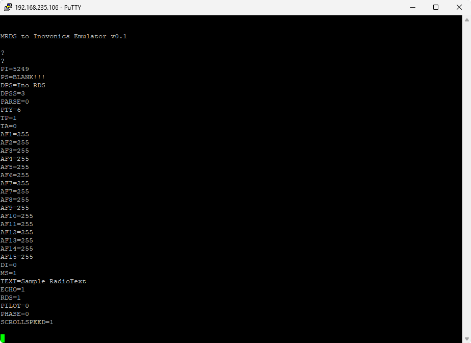

# MRDS1322 to Inovonics 720 Emulator

This program interfaces with an MRDS1322 RDS generator IC, commonly found in NiCom NTi FM transmitters, and emulates the protocol used by the Inovonics 720 RDS encoder.

This program was initially used to run on the built-in Raspberry Pi in the NiCom NTi 600 FM transmitter and instructions for doing so can be found [here](NiCom%20Setup.md).

## Supported Commands

The following commands are supported just like the Inovonics 720 RDS encoder. View the [Inovonics 720 manual](https://www.inovonicsbroadcast.com/uploads/2017/04/03/720ManualRev1.pdf) for more information.

| Command     | From    | Function                                     | Notes                                                       |
|-------------|---------|----------------------------------------------|-------------------------------------------------------------|
| PI          | Ino 720 | Sets the PI code.                            |                                                             |
| PS          | Ino 720 | Sets the static PS.                          |                                                             |
| DPS         | Ino 720 | Sets the scrolling DPS. Clear to use PS.     | Up to 80 characters instead of the original 128.            |
| DPSS        | Ino 720 | Sets the DPS scrolling speed.                | Ranges 0-255 instead of original 0-9.                       |
| PARSE       | Ino 720 | Sets how the DPS is parsed.                  | Supports only 0, 1 and 8.                                   |
| PTY         | Ino 720 | Sets the PTY code.                           |                                                             |
| TP          | Ino 720 | Sets if this is a traffic program.           |                                                             |
| TA          | Ino 720 | Sets if there is an active traffic program.  | Has no software timeout, use with caution.                  |
| AFx         | Ino 720 | Sets the alternative frequencies at index x. | 1-15 are supported.                                         |
| DI          | Ino 720 | Sets the DI flag.                            |                                                             |
| MS          | Ino 720 | Sets the MS flag.                            |                                                             |
| TEXT        | Ino 720 | Sets the RadioText.                          | Truncated beyond 64 characters.                             |
| ECHO        | Ino 720 | Configures if terminal input is echoed.      | Not persistent; Set initial state on command line.          |
| RDS         | Ino 730 | Sets if the RDS subcarrier is turned on.     |                                                             |
| PILOT       | NEW     | Configures the stereo pilot sync.            | On write, turns it on and off; On read returns if detected. |
| PHASE       | NEW     | Sets the phase offset from the stereo pilot. | Valid values are 0-15.                                      |
| SCROLLSPEED | NEW     | Configures the SCROLLSPD register.           | Valid values are 0 and 1.                                   |

Additionally, the ``SAVE`` and ``RESET`` commands are supported. You can also query all by sending ``?``.

## Usage

Run ``./MrdsControl`` without arguments to see full help. The only required option is ``-f`` specifying a path to the serial device file.

Once running you can connect to the multi-threaded TCP server using the "raw" option in PuTTY. The default port is ``10001``. To test connection, type ``?`` and press enter.